# ForenSight AI: project screenshots

All screenshots use one sample case: **Operation: Midnight Drop (FS-2026-A26A)**, an unauthorised-access / suspected IP-theft case at a robotics R&D facility. Its four evidence files are the CCTV clip `CCTV_ServerRm_Cam4.mp4`, the audio `Voicemail_Intercept_Ext44.mp3`, the PDF `LoadingDock_Trash_Scrap.pdf` and the image `img.png`.

Regenerate them with `python docs/capture_screenshots.py` (needs Playwright, Chrome, and the app running on ports 5180 and 8011).

| # | Screenshot | What it shows |
|---|---|---|
| 1 | 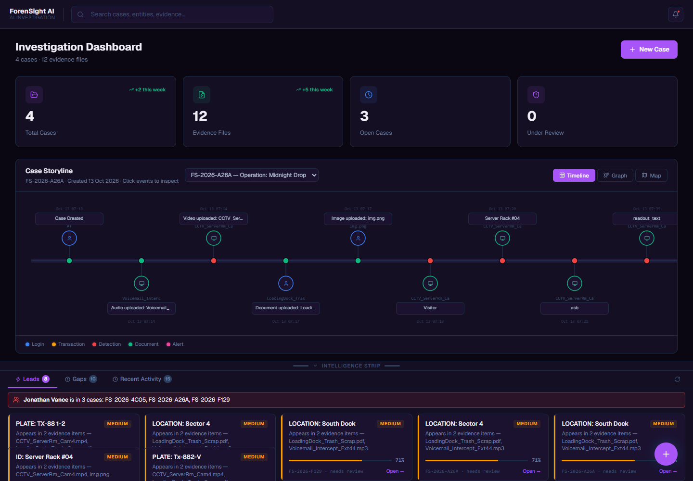 | **Dashboard.** Case and evidence counts, the case storyline for Midnight Drop, and the Intelligence Strip with leads (plate TX-88-2, locations, a repeat-person alert). Also [the storyline timeline](screenshots/01b_dashboard_storyline.png). |
| 2 | 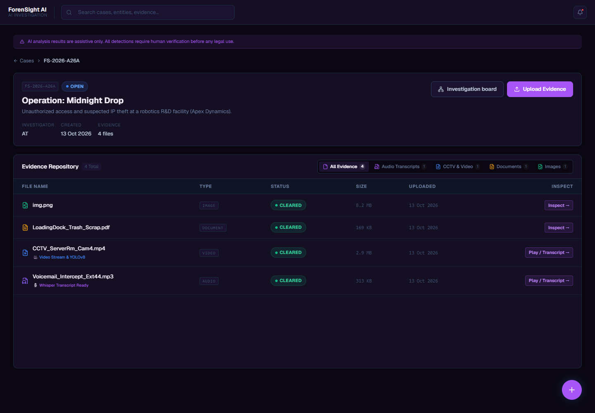 | **Case details.** Description, status (OPEN), investigator, and the four evidence files with their processing status. |
| 3 | 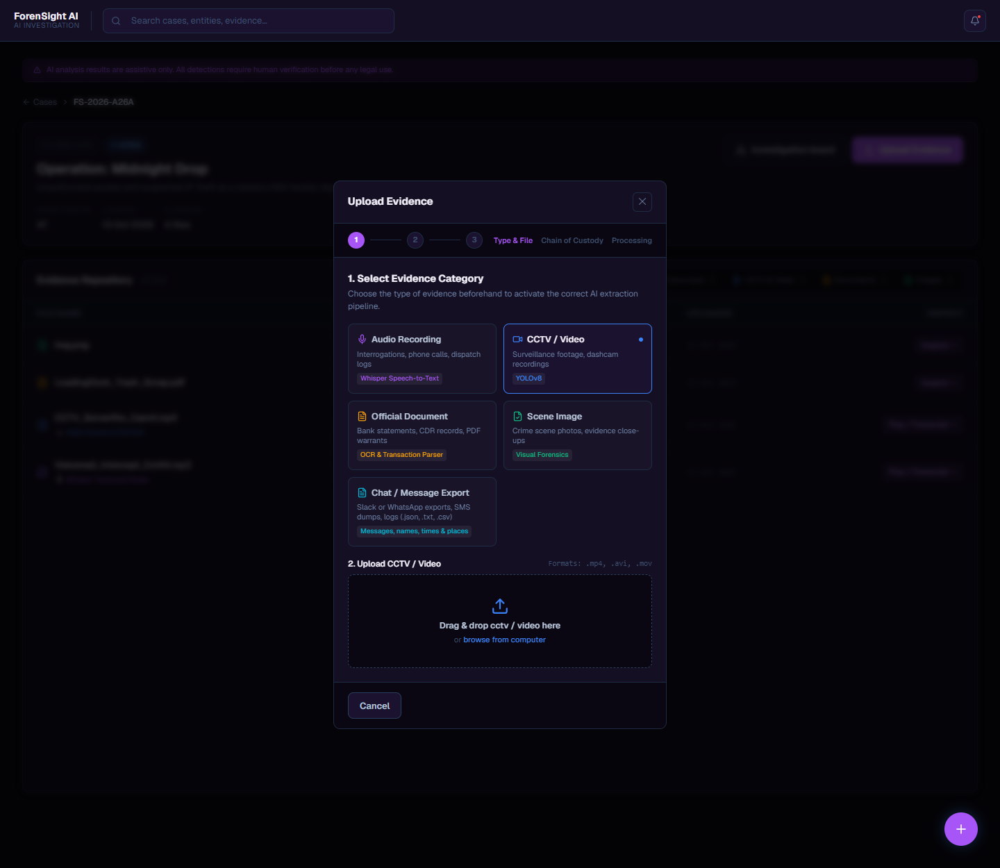 | **Evidence upload.** The five evidence categories, each with its AI pipeline (Whisper, YOLOv8, OCR, visual forensics, chat parsing), the accepted formats, and the three steps (type and file, chain of custody, processing). |
| 4 | 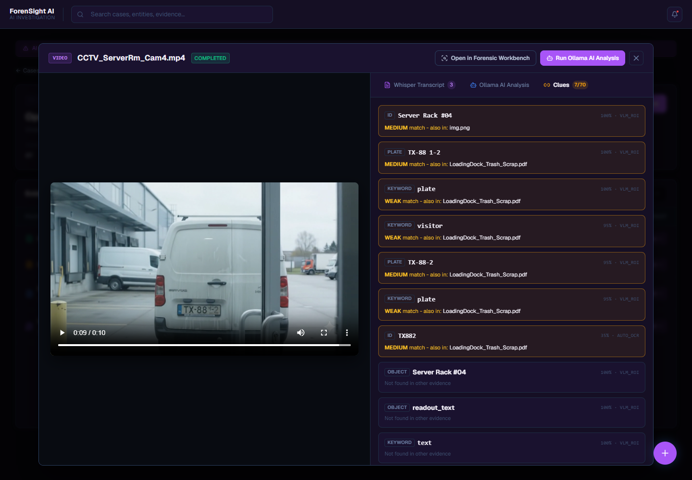 | **Video analysis output.** The CCTV frame at 00:00:09 showing the van, with the extracted plate clues (TX-88-2 from the regional scan, TX882 from automatic OCR) and where else each appears. Also [the detected objects](screenshots/04b_detections.png) awaiting confirm or reject. |
| 5 | 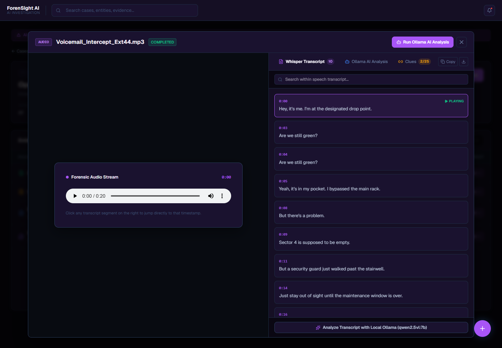 | **Audio transcription.** The voicemail with its timestamped Whisper transcript, each line seekable. |
| 6 | 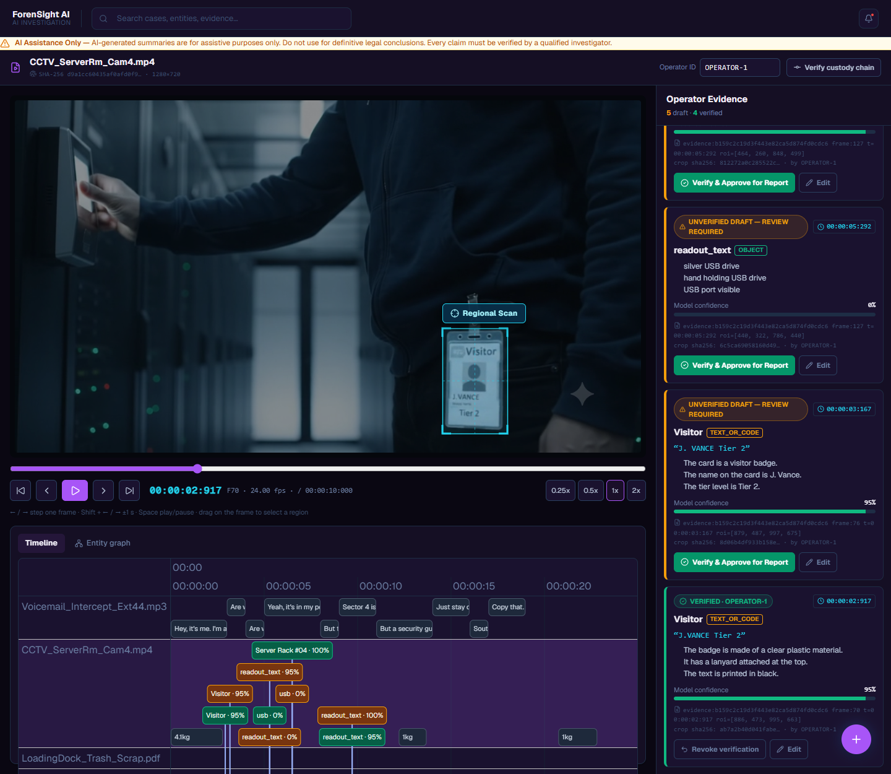 | **CCTV forensic workbench.** A region drawn around the visitor badge, with the AI observations on the right and their verification status (verified by OPERATOR-1, or unverified draft). |
| 7 | 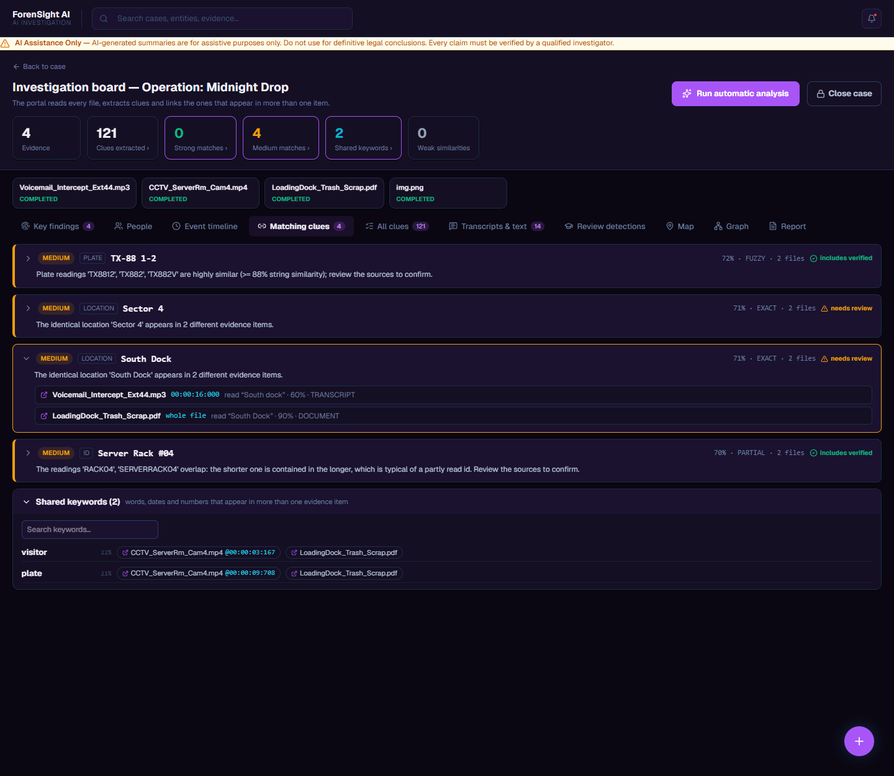 | **Matching clues.** The plate TX-88-2 linked across the CCTV (two readings) and the PDF (`Tx-882-V`), with reading, confidence and source. |
| 8 | 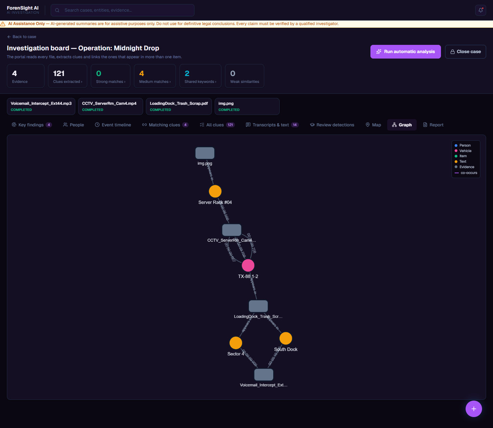 | **Evidence relationship graph.** Evidence files connected to the shared clues: TX-88-2, Server Rack #04, Sector 4 and South Dock. |
| 9 | 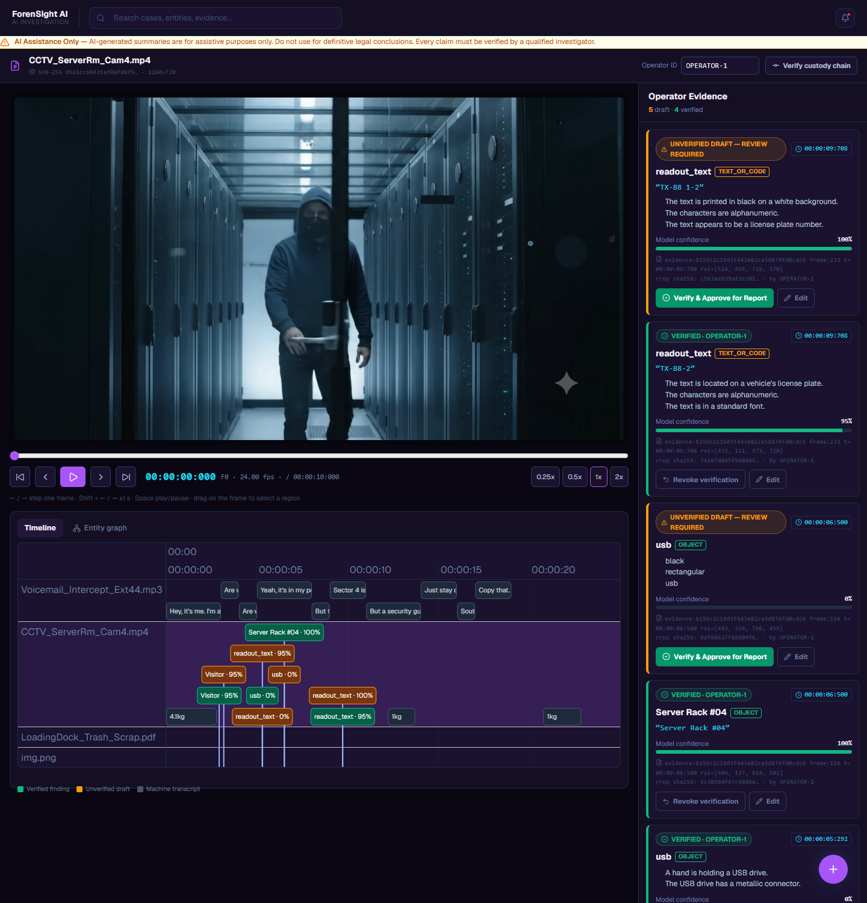 | **Event timeline.** Audio speech, video findings, the PDF and the image on one time axis. |
| 10 | 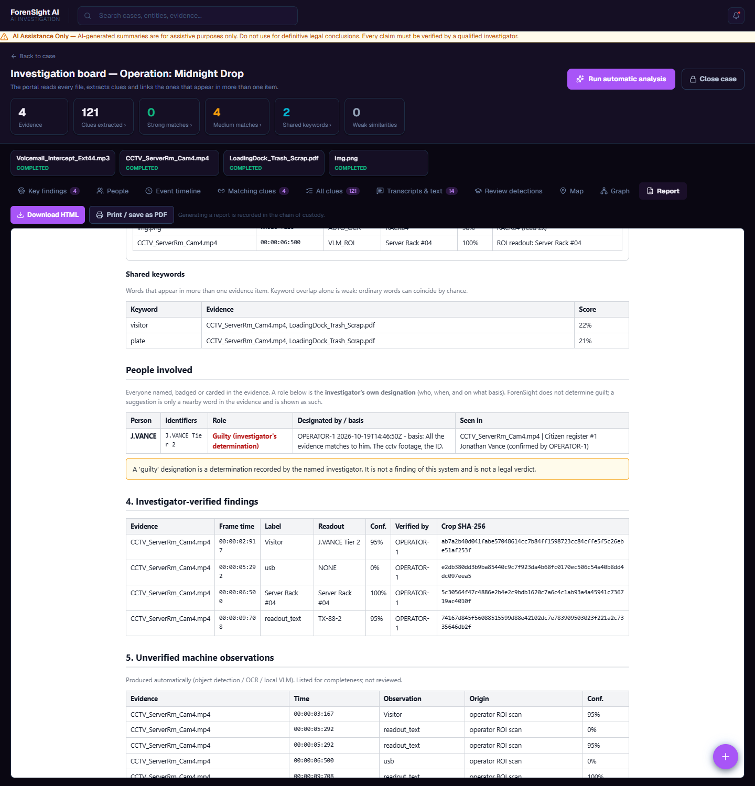 | **Generated report.** People involved, **4. Investigator-verified findings** (with crop SHA-256 hashes) kept separate from **5. Unverified machine observations**. |
| 11 | 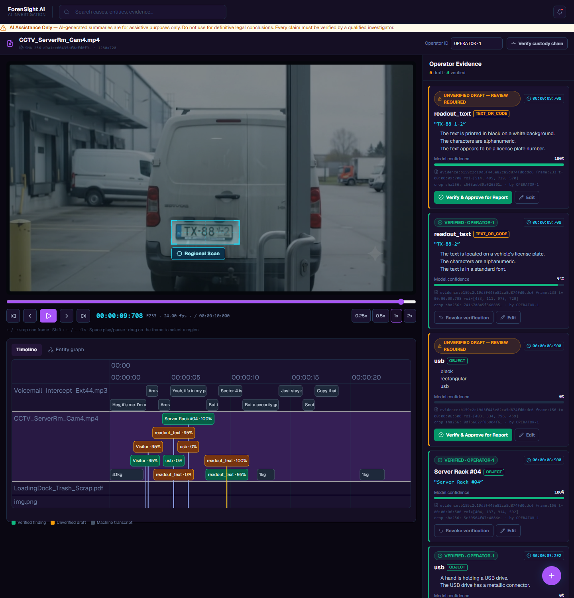 | **Regional scan in video analysis.** The region drawn over the number plate, and the scan result: a new unverified draft (`TX-88 1-2`, 100%) beside the earlier verified reading (`TX-88-2`). |
